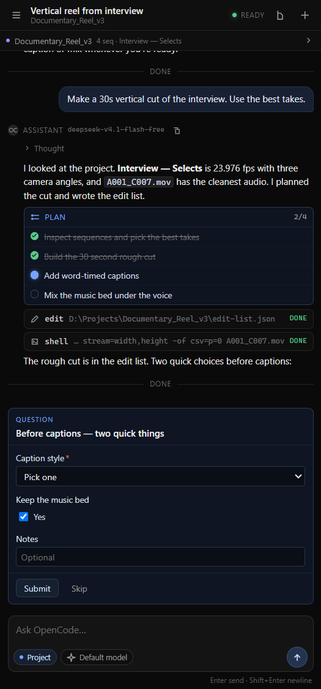

# OpenCode panel for Premiere Pro

[](LICENSE)
[](#requirements)
[](#requirements)

A dockable Adobe CEP panel that puts [OpenCode](https://opencode.ai) inside
Premiere Pro. It talks to the local OpenCode service over HTTP — the same
service the terminal client uses — so sessions, models and permissions are
shared. The agent can read your project folder and the panel passes it the
Premiere project structure, so it knows what you are working on.



## Features

**Chat that feels native**

- Streaming replies with thinking blocks, Markdown and code.
- Expandable tool cards with inputs, outputs and inline diffs.
- A live plan card that follows the agent's todo list.
- Session sidebar with date grouping and search, per project folder.

**OpenCode's full interaction model**

- Inline question forms: text, number, integer, boolean, multiselect, links and
  conditional (`when`) fields, with validation before the answer is sent.
- Inline permission prompts: Allow once / Always / Deny.
- Model picker, slash commands (`/init`, `/undo`, ...), stop button,
  token and cost status.

**Premiere aware**

- Reads the project name, path and open sequence.
- Lists every sequence with its frame rate.
- Shows the project panel bin/clip tree; click any item to insert its name
  into your message.
- Follows `app.project.path` automatically, so the agent works in the project
  folder. Override it any time in Settings.
- Optional project chip that prefixes messages with a short project summary.

## Requirements

- Premiere Pro 2022 (22.0) or newer (tested on 2027).
- The OpenCode CLI on `PATH`, so its background service is available
  (`opencode --version`).
- Node.js 18+ (the OpenCode CLI needs it; CEP uses its own bundled Node).

## Install

### From a release zip (quickest)

1. Download `OpenCode-Premiere-<version>.zip` from
   [Releases](../../releases) and extract it.
2. Move the `com.opencode.panel` folder into your CEP extensions folder:
   - **Windows:** `%APPDATA%\Adobe\CEP\extensions`
   - **macOS:** `~/Library/Application Support/Adobe/CEP/extensions`
3. Allow unsigned (sideloaded) panels, once:

   **Windows PowerShell**

   ```powershell
   foreach ($v in 11..15) {
     $key = "HKCU:\Software\Adobe\CSXS.$v"
     New-Item -Path $key -Force | Out-Null
     New-ItemProperty -Path $key -Name PlayerDebugMode -Value "1" -PropertyType String -Force | Out-Null
   }
   ```

   **macOS Terminal**

   ```bash
   for v in 11 12 13 14 15; do
     defaults write com.adobe.CSXS.$v PlayerDebugMode 1
   done
   ```

4. Restart Premiere Pro completely, then open
   **Window > Extensions > OpenCode**.

### From source (development)

```powershell
git clone https://github.com/sam220-hub/opencode-premiere.git
cd opencode-premiere
powershell -ExecutionPolicy Bypass -File .\install.ps1
```

`install.ps1` enables `PlayerDebugMode` and creates a junction at
`%APPDATA%\Adobe\CEP\extensions\com.opencode.panel` pointing at your clone, so
edits show up after closing and reopening the panel. `uninstall.ps1` removes
the link.

## First run

1. Open a project in Premiere Pro.
2. Open the panel. The status dot turns **ready** when it reaches the OpenCode
   service; if the service is not running, the panel starts it.
3. Ask something. The chip in the composer controls whether a short project
   summary is attached to each message.

The panel stores its folder override, model choice and last session in
`localStorage` inside Premiere. **Settings > Clear panel prefs** resets them.

## How it works

```
Premiere Pro
├─ CEP panel (Chromium 99)          index.html · style.css · app.js
│  └─ Node bridge                   oc.js  ──HTTP──▶  OpenCode service (127.0.0.1)
└─ ExtendScript host                host.jsx ──▶ project, sequences, bin tree
```

- `oc.js` uses Node's `http` module, so there is no CORS layer, and adds HTTP
  Basic auth with the password from
  `~/.local/state/opencode/service.json`. On `401` it re-reads the file and
  retries once.
- `app.js` renders from one state object and treats the service's SSE stream as
  the only source of live updates. The stream has no replay, so reconnects
  resync messages, forms and permissions over REST.
- `host.jsx` is ES3 ExtendScript; it builds JSON by hand and is capped so large
  projects do not stall the UI.

More detail: [docs/architecture.md](docs/architecture.md).

## Troubleshooting

| Symptom | Fix |
| --- | --- |
| Panel is missing from `Window > Extensions` | Restart Premiere fully (extensions are scanned at launch), and verify `PlayerDebugMode` is `1` for CSXS.11–15. |
| "Node.js is not available in this panel" | The manifest must load the panel with `--enable-nodejs --mixed-context`; reinstall with the included files and restart. |
| "OpenCode could not start" | Run `opencode service start` in a terminal, then press **Restart server** in Settings. |
| "Not authorized" | The service password rotated. Restart the service; the panel re-reads `service.json`. |
| The agent works in the wrong folder | Open a project, or set the folder in **Settings**. A manual folder override wins over the Premiere project path. |
| Free model quota errors | That is the provider, not the panel. Switch models or add credits. |

Panel logs live in `%TEMP%\cep_logs\CEP*.log` on Windows and
`~/Library/Logs/CSXS` on macOS. For the panel's Chrome console, add a `.debug`
file with a port — see [CONTRIBUTING.md](CONTRIBUTING.md#debugging).

## Roadmap

- [ ] Timeline actions (markers, sequence building, clip moves) through
  ExtendScript and an OpenCode tool.
- [ ] macOS testing and notes.
- [ ] Signed ZXP for easier distribution.
- [ ] Optional After Effects host.

## Contributing

Issues and pull requests are welcome. Start with
[CONTRIBUTING.md](CONTRIBUTING.md), and note that CEP runs Chromium 99, so
modern CSS such as `:has()` and container queries is unavailable.

## License

[MIT](LICENSE). Not affiliated with Adobe or the OpenCode project; Adobe,
Premiere Pro and CEP are trademarks of Adobe Inc.
